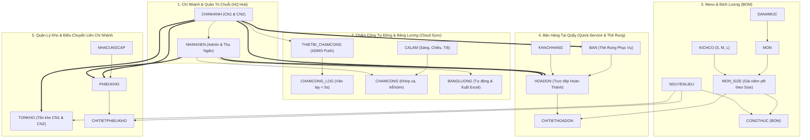

# TÀI LIỆU 00: TỔNG QUAN KIẾN TRÚC & PHÂN QUYỀN HỆ THỐNG CHUỖI CAFE

---

## 1. MÔ HÌNH VẬN HÀNH 5 PHÂN HỆ CỐT LÕI

Hệ thống quản lý chuỗi quán cà phê vận hành xoay quanh 18 bảng dữ liệu chuẩn hóa, phân chia thành 5 phân hệ độc lập nhưng liên kết chặt chẽ qua nền tảng Real-time Cloud:

---

## 2. DANH SÁCH 18 BẢNG DỮ LIỆU CHUẨN

| STT | Tên Bảng | Phân Hệ | Chức năng nghiệp vụ |
| :---: | :--- | :--- | :--- |
| 1 | `CHINHANH` | Chi Nhánh | Thông tin các cơ sở trong chuỗi (CN1 - Quận 1, CN2 - Cầu Giấy). |
| 2 | `NHANVIEN` | Nhân Sự | Hồ sơ nhân viên, chức vụ, mức lương giờ, tài khoản đăng nhập. |
| 3 | `THIETBI_CHAMCONG` | Chấm Công | Danh sách máy chấm công vân tay từng chi nhánh (IP LAN, Serial, Giao thức ADMS). |
| 4 | `CHAMCONG_LOG` | Chấm Công | Nhật ký quẹt vân tay đẩy về thời gian thực từ máy chấm công (< 5 giây). |
| 5 | `CALAM` | Ca Làm | Danh mục ca làm việc (Ca Sáng: 06:30 - 12:00, Ca Chiều: 12:00 - 17:30, Ca Tối: 17:30 - 23:00). |
| 6 | `CHAMCONG` | Ca Làm | Bảng chấm công thông minh: Tự động so khớp ca, tính số phút đi trễ, về sớm, giờ thực làm. |
| 7 | `BANGLUONG` | Tính Lương | Chốt lương tự động (`Tổng giờ × Lương/h + Phụ cấp - Phạt trễ`) & Hỗ trợ xuất file Excel. |
| 8 | `DANHMUC` | Menu | Phân loại đồ uống (Cà phê, Trà trái cây, Đá xay, Bánh). |
| 9 | `MON` | Menu | Danh sách các món cơ sở và icon minh họa. |
| 10 | `KICHCO` | Menu | Danh mục kích cỡ (Size S, M, L). |
| 11 | `MON_SIZE` | Menu | Giá bán niêm yết theo từng kích cỡ ly. |
| 12 | `NGUYENLIEU` | Định Lượng | Danh mục vật tư (Hạt cafe, sữa tươi, sữa đặc, đường, syrup, trà...). |
| 13 | `CONGTHUC` | Định Lượng | Định lượng chi tiết từng gam, ml nguyên liệu cho từng `MON_SIZE`. |
| 14 | `BAN` | Bán Hàng | Sơ đồ Thẻ rung phục vụ theo từng chi nhánh (`Thẻ 01` $\rightarrow$ `Thẻ 10`) và trạng thái sử dụng. |
| 15 | `HOADON` | Bán Hàng | Hóa đơn bán lẻ (Mã HĐ, Chi nhánh, Thu ngân, Thẻ, Thành tiền, Giảm giá %, Tổng thanh toán, Hình thức TT). |
| 16 | `CHITIETHOADON` | Bán Hàng | Chi tiết từng món_size bán ra, số lượng, đơn giá, thành tiền. |
| 17 | `TONKHO` | Kho Bãi | Tồn kho thực tế của từng nguyên liệu tại từng chi nhánh, tự động trừ theo BOM. |
| 18 | `PHIEUKHO` | Kho Bãi | Phiếu kho đa năng: Nhập hàng NCC, Xuất hao hụt, Điều chuyển liên chi nhánh. |

---

## 3. TÁC NHÂN (ACTORS) & MA TRẬN PHÂN QUYỀN (RBAC TINH GỌN)

Theo mô hình **Bán nhanh tại quầy (Quick-Service / Takeaway)**, hệ thống đã tinh gọn hoàn toàn phân quyền:
* **Không cấp tài khoản đăng nhập màn hình cho Barista và Phục vụ** (Barista xem phiếu giấy in vật lý từ máy in bill quầy pha chế).
* Duy trì đúng 2 nhóm vai trò người dùng trong hệ thống:

| Chức năng hệ thống | Bảng dữ liệu tác động | Quản Trị Chuỗi / Chủ Quán (Admin - NV001) | Thu Ngân Bán Hàng (Cashier/POS - NV002) |
| :--- | :--- | :---: | :---: |
| **Màn hình Chủ Quản Lý Chuỗi (HQ Dashboard)** | `CHINHANH`, `HOADON`, `TONKHO` | Toàn quyền xem hợp nhất toàn chuỗi & so sánh trực diện CN1 vs CN2 | ❌ |
| **Bán hàng & Xuất hóa đơn tại quầy** | `HOADON`, `CHITIETHOADON`, `BAN` | Xem & Phê duyệt | Toàn quyền (Thu tiền, áp mã giảm giá %, in 2 liên bill) |
| **Quản lý Thẻ Rung** | `BAN` | Cấu hình thẻ | Chọn thẻ cho khách, Chuyển thẻ, Thu thẻ về trạng thái Trống |
| **Quản lý Máy Chấm Công Cloud** | `THIETBI_CHAMCONG`, `CHAMCONG_LOG` | Toàn quyền cấu hình IP, Serial, Test kết nối, xem Live Push Log | ❌ |
| **Bảng Chấm Công & Tính Lương** | `CHAMCONG`, `BANGLUONG` | Xem toàn chuỗi, Tự động chốt lương & Xuất file Excel | ❌ |
| **Quản lý Kho & Tồn Kho BOM** | `TONKHO`, `PHIEUKHO`, `CONGTHUC` | Toàn quyền kiểm kê, nhập hàng, điều chuyển giữa 2 chi nhánh | ❌ |
