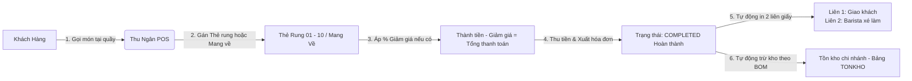

# TÀI LIỆU 01: NGHIỆP VỤ BÁN HÀNG TẠI QUẦY (POS), THẺ RUNG & IN LIÊN BẾP VẬT LÝ

---

## 1. MÔ TẢ TỔNG QUAN

Hệ thống áp dụng mô hình vận hành hiện đại **Bán nhanh tại quầy (Quick-Service / Takeaway / Thẻ rung)**. Khách hàng thanh toán ngay tại quầy thu ngân, nhận thẻ rung (hoặc cầm phiếu) và nhận đồ uống khi thẻ báo rung.

---

## 2. QUẢN LÝ THẺ RUNG PHỤC VỤ (BẢNG `BAN`)

### 2.1. Cấu trúc và phân chia thẻ
* Toàn bộ khái niệm "Bàn" trên giao diện thu ngân được chuyển đổi đồng nhất thành **"Thẻ"** (`Thẻ 01`, `Thẻ 02`,... `Thẻ 10`).
* Trạng thái thẻ:
  * `Trong` (Màu xanh): Thẻ đang sẵn sàng tại quầy để phát cho khách tiếp theo.
  * `CoKhach` (Màu cam/đỏ): Khách đang cầm thẻ rung chờ lấy đồ uống hoặc đang ngồi thưởng thức.
* **Chức năng thu hồi thẻ:** Sau khi khách nhận xong đồ uống và trả lại thẻ rung tại quầy, Thu ngân bấm nút **`[✓ Thu thẻ trống]`** ngay trên ô thẻ để giải phóng thẻ về trạng thái `Trong`.

### 2.2. Chuyển thẻ cho khách
* Khi khách đổi chỗ hoặc thẻ rung bị lỗi pin, Thu ngân sử dụng nút **`🔄 Chuyển Thẻ Cho Khách`**:
  * Chọn thẻ nguồn $\rightarrow$ Hệ thống lọc ra danh sách thẻ trống cùng chi nhánh $\rightarrow$ Bấm chọn thẻ đích để chuyển toàn bộ đơn hàng sang thẻ mới.

---

## 3. GIAO DIỆN & LUỒNG THANH TOÁN TINH GỌN TẠI QUẦY

### 3.1. Thiết kế giao diện POS tối ưu
1. **Bỏ mục Khách hàng:** Giao diện thu ngân lược bỏ trường chọn khách hàng để danh sách sản phẩm mở rộng tối đa, không để khoảng trống thừa.
2. **Khung Giảm Giá theo phần trăm (%):**
   * Các phím chọn nhanh: `0%`, `5%`, `10%`, `15%`, `20%`, `50%` và ô nhập % tùy chỉnh.
   * Hệ thống tự động tính chính xác số tiền được giảm = $\text{Thành tiền} \times \% \text{ giảm}$.
3. **Khu vực tổng kết thanh toán:**
   * **Thành tiền:** Tổng giá trị sản phẩm trước giảm giá.
   * **Giảm giá:** Số tiền giảm tương ứng với % đã chọn.
   * **TỔNG THANH TOÁN:** $\text{Thành tiền} - \text{Giảm giá}$.
4. **Hai nút tác vụ cốt lõi duy nhất:**
   * `✓ THU TIỀN & XUẤT HÓA ĐƠN` *(Nút chính nổi bật)*.
   * `🔄 Chuyển Thẻ Cho Khách` *(Nút phụ khi khách đổi thẻ)*.

---

## 4. VÒNG ĐỜI ĐƠN HÀNG & QUY TRÌNH IN LIÊN BẾP VẬT LÝ

### 4.1. Rút gọn vòng đời đơn hàng (Order Lifecycle)
* **Luồng cũ:** Mới tạo $\rightarrow$ Chờ pha chế $\rightarrow$ Đang pha $\rightarrow$ Đã phục vụ $\rightarrow$ Hoàn thành.
* **Luồng mới:** Khi Thu ngân bấm **"THU TIỀN & XUẤT HÓA ĐƠN"**, hệ thống gán thẳng `TrangThai = 'HoanThanh'` (`COMPLETED`), bỏ qua hoàn toàn các trạng thái trung gian, tự động trừ kho nguyên liệu theo định lượng (BOM).

### 4.2. Quy trình in phiếu bếp vật lý (In 2 liên chuẩn K80/K58)
Quầy Barista hoạt động hoàn toàn bằng phiếu in giấy xé từ máy in, không cần trang bị màn hình hay máy tính bảng:
* **Liên 1 - Hóa đơn giao khách:** Đầy đủ thông tin chi nhánh, số HĐ, món, Thành tiền, Giảm giá, Tổng thanh toán, Tiền khách đưa, Tiền thừa trả lại và mật khẩu Wi-Fi.
* **Liên 2 - Phiếu chế biến đồ uống (Barista/Bếp):** Nổi bật **SỐ THẺ RUNG** cực lớn (`🏷️ THẺ 01` hoặc `MANG VỀ`), danh sách món, kích cỡ Size và số lượng in đậm (`x1`, `x2`). Barista xé phiếu, cắm lên quầy làm theo thứ tự và bấm chuông gọi thẻ rung khi hoàn tất.
