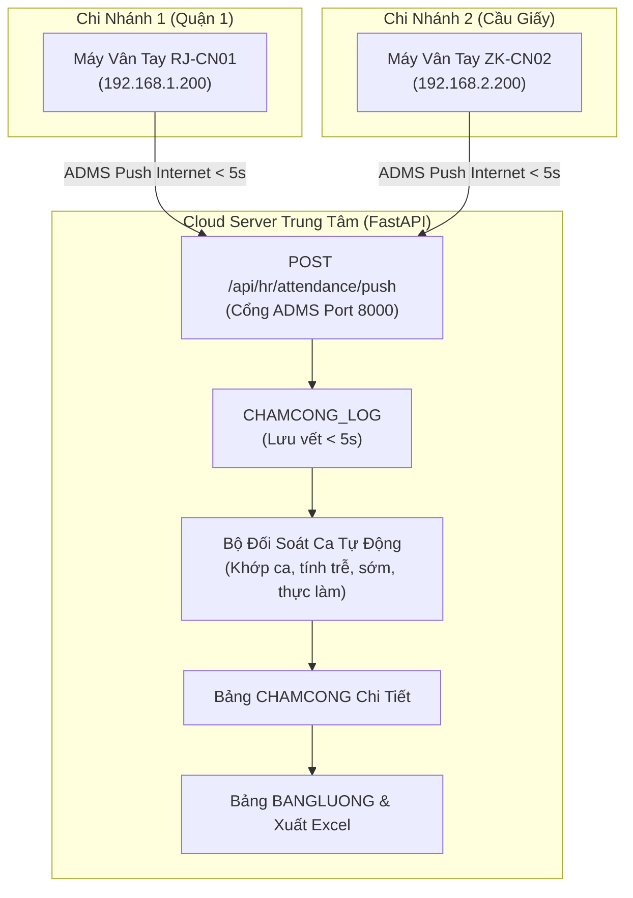

# TÀI LIỆU 04: TÍCH HỢP MÁY CHẤM CÔNG CLOUD & TÍNH LƯƠNG TỰ ĐỘNG

---

## 1. MÔ TẢ TỔNG QUAN

Hệ thống chấm công và tính lương vận hành theo kiến trúc **Real-time Cloud Sync** tập trung cho toàn bộ các chi nhánh trong chuỗi:
* Dữ liệu quẹt vân tay từ các máy chấm công tại **Chi nhánh 1 (Quận 1)** và **Chi nhánh 2 (Cầu Giấy)** được tự động đẩy về máy chủ trung tâm qua mạng Internet bằng giao thức **ADMS / Cloud Push** trong vòng **dưới 5 giây**.
* Hoàn toàn loại bỏ thao tác rút USB, cắm máy tính tải file thủ công hoặc phụ thuộc vào IP tĩnh nội bộ.

---

## 2. QUẢN LÝ THIẾT BỊ MÁY CHẤM CÔNG (`THIETBI_CHAMCONG`)

Hệ thống cho phép Quản trị viên (Admin / Chủ chuỗi) giám sát và cấu hình các máy chấm công theo từng chi nhánh:
* `MaTB`: Mã thiết bị định danh (`TB01`, `TB02`).
* `TenTB`: Tên mô tả vị trí lắp đặt (ví dụ: *Ronald Jack Pro Cloud - Cửa Chính CN1*).
* `MaCN`: Gán máy thuộc chi nhánh nào (`CN01` hoặc `CN02`).
* `SerialNumber`: Số serial phần cứng của máy (ví dụ: `RJ-CN01-8899`).
* `IP_LAN`: Địa chỉ IP nội bộ tại quán (ví dụ: `192.168.1.200`).
* `Protocol`: Giao thức đẩy dữ liệu (`ADMS / Cloud Push`).
* `TrangThai`: Đèn báo trạng thái kết nối thời gian thực (`Online` / `Offline`).
* `LastSync`: Thời điểm nhận được bản tin ping/log gần nhất từ máy.

---

## 3. ĐỒNG BỘ THỜI GIAN THỰC & BỘ ĐỐI SOÁT CA THÔNG MINH

### 3.1. Tiếp nhận và khử trùng lặp (Deduplication)
* Khi nhân viên quẹt vân tay thành công, máy chấm công đóng gói bản tin JSON/HTTP đẩy ngay về endpoint máy chủ Cloud trong $\le 5$ giây.
* **Bộ đệm chống spam:** Nếu cùng 1 nhân viên quẹt vân tay liên tiếp nhiều lần trong vòng 2 phút, hệ thống tự động ghi nhận lần quẹt đầu tiên và bỏ qua các lần quẹt thừa.

### 3.2. Thuật toán so khớp ca làm việc tự động
Hệ thống tự động so khớp thời gian quẹt với danh mục ca làm (`CALAM`):
* `CA_SANG`: 06:30 - 12:00 (Quy định 5.5 tiếng)
* `CA_CHIEU`: 12:00 - 17:30 (Quy định 5.5 tiếng)
* `CA_TOI`: 17:30 - 23:00 (Quy định 5.5 tiếng)

**Quy tắc phân loại:**
1. **Xác định Có mặt / Vắng mặt:** Nhân viên có log quẹt hợp lệ trong khung giờ ca trực được đánh dấu là `Có mặt`.
2. **Tính số phút đi trễ (`DiTrePhut`):**
   $$\text{DiTrePhut} = \max(0, \text{GioVaoThucTe} - \text{GioBatDauCa})$$
   *(Ví dụ: Ca bắt đầu lúc 06:30, quẹt lúc 06:42 $\rightarrow$ Đi trễ 12 phút).*
3. **Tính số phút về sớm (`VeSomPhut`):**
   $$\text{VeSomPhut} = \max(0, \text{GioKetThucCa} - \text{GioRaThucTe})$$
   *(Ví dụ: Ca kết thúc lúc 12:00, quẹt ra lúc 11:48 $\rightarrow$ Về sớm 12 phút).*
4. **Tính tổng thời gian làm việc thực tế (`SoGioThucTe`):**
   $$\text{SoGioThucTe} = \frac{\text{GioRa} - \text{GioVao}}{60 \text{ phút}}$$

---

## 4. BẢNG TÍNH LƯƠNG TỰ ĐỘNG & XUẤT EXCEL (`BANGLUONG`)

### 4.1. Công thức tính lương tự động
Vào kỳ chốt lương (hàng tuần hoặc hàng tháng), quản lý bấm **"💰 Chốt Lương Tự Động"**:
$$\text{Thực Lãnh} = (\text{Tổng Giờ Làm Thực Tế} \times \text{Lương Theo Giờ}) + \text{Phụ Cấp} - \text{Phạt Đi Trễ}$$

* **Lương Theo Giờ (`LuongTheoGio`):** Lấy từ hợp đồng của nhân viên trong bảng `NHANVIEN` (Thu ngân: 25.000đ/h, Pha chế: 28.000đ/h, Quản lý: 50.000đ/h).
* **Phụ Cấp (`PhuCap`):** Trợ cấp ăn ca, gửi xe, trách nhiệm.
* **Phạt Đi Trễ (`PhatDiTre`):** Tự động khấu trừ dựa trên tổng số phút đi trễ tích lũy từ bảng `CHAMCONG` (ví dụ: trễ $> 10$ phút phạt $2.000\text{đ/phút}$).

### 4.2. Chức năng "Xuất Bảng Lương Excel" (1-Click Export)
* Hệ thống tích hợp nút bấm **"📊 Xuất Bảng Lương Excel"** trên giao diện quản trị.
* Xuất file định dạng `.csv` chuẩn mã hóa `UTF-8 BOM` tương thích 100% với Microsoft Excel (không bị lỗi font tiếng Việt).
* File tải về máy tính chứa đầy đủ các cột: Mã NV, Họ Tên, Chi Nhánh, Chức Vụ, Kỳ Lương, Tổng Giờ Làm, Lương/h, Phụ Cấp, Phạt Trễ, Thực Lãnh, Trạng Thái.
