# TÀI LIỆU 06: MÔ HÌNH DỮ LIỆU ERD & TỪ ĐIỂN DỮ LIỆU (DATA DICTIONARY)

---

## 1. SƠ ĐỒ THỰC THỂ LIÊN KẾT (ERD) - 16 BẢNG CHUẨN

```plantuml
@startuml
hide circle
skinparam linetype ortho
skinparam shadowing false
skinparam roundcorner 6
skinparam nodesep 55
skinparam ranksep 65
skinparam defaultFontName "Segoe UI"
skinparam defaultFontSize 11

skinparam package {
  BorderThickness 2
  FontSize 13
  FontStyle bold
}

skinparam entity {
  BackgroundColor #FFFFFF
  BorderThickness 1.2
}

' ========================================================
' 1. CHI NHÁNH & NHÂN SỰ
' ========================================================
package "1. CHI NHÁNH & NHÂN SỰ" #EFF6FF {
  skinparam entityBorderColor #2563EB
  skinparam entityHeaderBackgroundColor #DBEAFE
  skinparam ArrowColor #1D4ED8

  entity "CHINHANH" as CHINHANH {
    * MaCN : varchar(20) <<PK>>
    --
    TenCN : nvarchar(100)
    DiaChi : nvarchar(255)
    SDT : varchar(15)
    TrangThai : varchar(20)
  }

  entity "NHANVIEN" as NHANVIEN {
    * MaNV : varchar(20) <<PK>>
    --
    TenNV : nvarchar(100)
    SDT : varchar(15)
    ChucVu : nvarchar(50)
    LuongTheoGio : decimal(18,2)
    TenDangNhap : varchar(50)
    MatKhau : varchar(255)
    MaCN : varchar(20) <<FK>>
  }
}

' ========================================================
' 2. MÁY CHẤM CÔNG CLOUD, CA LÀM & TÍNH LƯƠNG
' ========================================================
package "2. MÁY CHẤM CÔNG CLOUD, CA LÀM & TÍNH LƯƠNG" #F3E8FF {
  skinparam entityBorderColor #7C3AED
  skinparam entityHeaderBackgroundColor #EDE9FE
  skinparam ArrowColor #6D28D9

  entity "THIETBI_CHAMCONG" as THIETBI_CHAMCONG {
    * MaTB : varchar(20) <<PK>>
    --
    TenTB : nvarchar(100)
    MaCN : varchar(20) <<FK>>
    SerialNumber : varchar(50) <<Unique>>
    IP_LAN : varchar(30)
    Protocol : varchar(50)
    TrangThai : varchar(20)
    LastSync : varchar(30)
    TongLog : int
  }

  entity "CHAMCONG_LOG" as CHAMCONG_LOG {
    * MaLog : varchar(30) <<PK>>
    --
    MaNV : varchar(20) <<FK>>
    MaCN : varchar(20) <<FK>>
    MaTB : varchar(20) <<FK>>
    ThoiGian : datetime
    KieuQuet : varchar(20)
    Status : nvarchar(100)
  }

  entity "CALAM" as CALAM {
    * MaCa : varchar(20) <<PK>>
    --
    TenCa : nvarchar(50)
    GioBatDau : time
    GioKetThuc : time
    SoGioQuyDinh : float
  }

  entity "CHAMCONG" as CHAMCONG {
    * MaChamCong : bigint <<PK, id>>
    --
    MaNV : varchar(20) <<FK>>
    MaCa : varchar(20) <<FK>>
    NgayLam : date
    GioVao : time
    GioRa : time
    DiTrePhut : int
    VeSomPhut : int
    SoGioThucTe : float
    TrangThai : nvarchar(50)
  }

  entity "BANGLUONG" as BANGLUONG {
    * MaBangLuong : varchar(30) <<PK>>
    --
    MaNV : varchar(20) <<FK>>
    Thang : int
    Nam : int
    TongGioLam : float
    LuongTheoGio : decimal(18,2)
    PhuCap : decimal(18,2)
    PhatDiTre : decimal(18,2)
    ThucLinh : decimal(18,2)
    TrangThai : nvarchar(50)
  }
}

' ========================================================
' 3. MENU & ĐỊNH LƯỢNG (BOM)
' ========================================================
package "3. MENU & ĐỊNH LƯỢNG PHA CHẾ" #F0FDF4 {
  skinparam entityBorderColor #16A34A
  skinparam entityHeaderBackgroundColor #DCFCE7
  skinparam ArrowColor #15803D

  entity "DANHMUC" as DANHMUC {
    * MaDM : varchar(20) <<PK>>
    --
    TenDM : nvarchar(100)
  }

  entity "MON" as MON {
    * MaMon : varchar(20) <<PK>>
    --
    TenMon : nvarchar(100)
    MaDM : varchar(20) <<FK>>
    HinhAnh : varchar(255)
    TrangThai : varchar(20)
  }

  entity "KICHCO" as KICHCO {
    * MaSize : varchar(10) <<PK>>
    --
    TenSize : nvarchar(20)
  }

  entity "MON_SIZE" as MON_SIZE {
    * MaMonSize : varchar(30) <<PK>>
    --
    MaMon : varchar(20) <<FK>>
    MaSize : varchar(10) <<FK>>
    GiaBan : decimal(18,2)
  }

  entity "CONGTHUC" as CONGTHUC {
    * MaMonSize : varchar(30) <<PK,FK>>
    * MaNL : varchar(20) <<PK,FK>>
    --
    SoLuongTieuHao : float
  }

  entity "NGUYENLIEU" as NGUYENLIEU {
    * MaNL : varchar(20) <<PK>>
    --
    TenNL : nvarchar(100)
    DonViTinh : nvarchar(20)
    NguongBao : float
  }
}

' ========================================================
' 4. BÀN & BÁN HÀNG (POS)
' ========================================================
package "4. BÁN HÀNG & PHỤC VỤ (POS)" #FEFCE8 {
  skinparam entityBorderColor #CA8A04
  skinparam entityHeaderBackgroundColor #FEF9C3
  skinparam ArrowColor #A16207

  entity "BAN" as BAN {
    * MaBan : varchar(30) <<PK>>
    --
    SoBan : nvarchar(20) ' Thẻ 01 - Thẻ 10
    KhuVuc : nvarchar(50)
    MaCN : varchar(20) <<FK>>
    TrangThai : varchar(20) ' Trong / CoKhach
  }

  entity "KHACHHANG" as KHACHHANG {
    * MaKH : varchar(20) <<PK>>
    --
    TenKH : nvarchar(100)
    SDT : varchar(15) <<Unique>>
    DiemTichLuy : int
  }

  entity "HOADON" as HOADON {
    * MaHD : varchar(30) <<PK>>
    --
    MaCN : varchar(20) <<FK>>
    MaBan : varchar(30) <<FK, null>> ' Thẻ rung
    MaNV : varchar(20) <<FK>>
    MaKH : varchar(20) <<FK, null>>
    NgayLap : datetime
    TongTien : decimal(18,2)
    GiamGia : decimal(18,2)
    GiamGiaPct : int
    TongThanhToan : decimal(18,2)
    HinhThucTT : varchar(30)
    TrangThai : varchar(20) ' HoanThanh (Completed trực tiếp)
  }

  entity "CHITIETHOADON" as CHITIETHOADON {
    * MaCTHD : bigint <<PK, id>>
    --
    MaHD : varchar(30) <<FK>>
    MaMonSize : varchar(30) <<FK>>
    SoLuong : int
    DonGia : decimal(18,2)
    ThanhTien : decimal(18,2)
  }
}

' ========================================================
' 5. QUẢN LÝ KHO
' ========================================================
package "5. QUẢN LÝ KHO" #FFF1F2 {
  skinparam entityBorderColor #E11D48
  skinparam entityHeaderBackgroundColor #FFE4E6
  skinparam ArrowColor #BE123C

  entity "TONKHO" as TONKHO {
    * MaCN : varchar(20) <<PK,FK>>
    * MaNL : varchar(20) <<PK,FK>>
    --
    SoLuongTon : float
  }

  entity "NHACUNGCAP" as NHACUNGCAP {
    * MaNCC : varchar(20) <<PK>>
    --
    TenNCC : nvarchar(150)
    SDT : varchar(15)
  }

  entity "PHIEUKHO" as PHIEUKHO {
    * MaPhieu : varchar(30) <<PK>>
    --
    LoaiPhieu : varchar(20)
    MaCN : varchar(20) <<FK>>
    MaNCC : varchar(20) <<FK, null>>
    MaNV : varchar(20) <<FK>>
    NgayLap : datetime
    TongTien : decimal(18,2)
  }

  entity "CHITIETPHIEUKHO" as CHITIETPHIEUKHO {
    * MaPhieu : varchar(30) <<PK,FK>>
    * MaNL : varchar(20) <<PK,FK>>
    --
    SoLuong : float
    DonGia : decimal(18,2)
  }
}

' ========================================================
' QUAN HỆ BẢN SỐ
' ========================================================
CHINHANH "1" ||--o{ "N" NHANVIEN : "thuộc"

NHANVIEN "1" ||--o{ "N" CHAMCONG : "chấm công"
CALAM "1" ||--o{ "N" CHAMCONG : "theo ca"
NHANVIEN "1" ||--o{ "N" BANGLUONG : "lĩnh lương"

DANHMUC "1" ||--o{ "N" MON : "phân loại"
MON "1" ||--|{ "N" MON_SIZE : "có size"
KICHCO "1" ||--o{ "N" MON_SIZE : "kích cỡ"

MON_SIZE "1" ||--|{ "N" CONGTHUC : "định lượng"
NGUYENLIEU "1" ||--o{ "N" CONGTHUC : "thành phần (N - N)"

CHINHANH "1" ||--o{ "N" BAN : "sở hữu"
CHINHANH "1" ||--o{ "N" HOADON : "doanh thu"
BAN "0..1" ||--o{ "N" HOADON : "phục vụ"
KHACHHANG "0..1" ||--o{ "N" HOADON : "mua"
NHANVIEN "1" ||--o{ "N" HOADON : "lập bill"

HOADON "1" ||--|{ "N" CHITIETHOADON : "chứa"
MON_SIZE "1" ||--o{ "N" CHITIETHOADON : "bán ra (N - N)"

CHINHANH "1" ||--o{ "N" TONKHO : "quản lý"
NGUYENLIEU "1" ||--o{ "N" TONKHO : "lưu trữ (N - N)"

NHACUNGCAP "0..1" ||--o{ "N" PHIEUKHO : "cung cấp"
CHINHANH "1" ||--o{ "N" PHIEUKHO : "kho tại"
NHANVIEN "1" ||--o{ "N" PHIEUKHO : "thực hiện"

PHIEUKHO "1" ||--|{ "N" CHITIETPHIEUKHO : "chi tiết"
NGUYENLIEU "1" ||--o{ "N" CHITIETPHIEUKHO : "vật tư (N - N)"

@enduml
```

---

## 2. TỪ ĐIỂN DỮ LIỆU CHI TIẾT (DATA DICTIONARY)

### 2.1. Phân hệ Chi Nhánh & Nhân Sự

#### Bảng `CHINHANH`
| Tên Cột | Kiểu Dữ Liệu | Khóa | Nullable | Mô tả |
| :--- | :--- | :---: | :---: | :--- |
| `MaCN` | `varchar(20)` | **PK** | No | Mã định danh chi nhánh (vd: `CN01`, `CN02`) |
| `TenCN` | `nvarchar(100)` | | No | Tên chi nhánh (vd: Cà Phê Ban Mê - Quận 1) |
| `DiaChi` | `nvarchar(255)` | | No | Địa chỉ cụ thể |
| `SDT` | `varchar(15)` | | Yes | Hotline quán |
| `TrangThai` | `varchar(20)` | | No | `HoatDong`, `TamNghi` |

#### Bảng `NHANVIEN`
| Tên Cột | Kiểu Dữ Liệu | Khóa | Nullable | Mô tả |
| :--- | :--- | :---: | :---: | :--- |
| `MaNV` | `varchar(20)` | **PK** | No | Mã nhân viên (vd: `NV001`) |
| `TenNV` | `nvarchar(100)` | | No | Họ và tên |
| `SDT` | `varchar(15)` | | Yes | Số điện thoại cá nhân |
| `ChucVu` | `nvarchar(50)` | | No | Quản lý, Thu ngân, Pha chế, Phục vụ |
| `LuongTheoGio`| `decimal(18,2)` | | No | Mức lương / giờ (vd: 25.000) |
| `TenDangNhap` | `varchar(50)` | | No | Tên đăng nhập hệ thống POS |
| `MatKhau` | `varchar(255)` | | No | Mật khẩu (đã băm BCrypt/SHA256) |
| `MaCN` | `varchar(20)` | **FK** | No | Làm việc tại chi nhánh nào |

---

### 2.2. Phân hệ Ca Làm & Lương

#### Bảng `CALAM`
| Tên Cột | Kiểu Dữ Liệu | Khóa | Nullable | Mô tả |
| :--- | :--- | :---: | :---: | :--- |
| `MaCa` | `varchar(20)` | **PK** | No | Mã ca (vd: `CA_SANG`, `CA_CHIEU`, `CA_TOI`) |
| `TenCa` | `nvarchar(50)` | | No | Tên ca hiển thị |
| `GioBatDau` | `time` | | No | Giờ bắt đầu (vd: `06:30:00`) |
| `GioKetThuc` | `time` | | No | Giờ kết thúc (vd: `12:00:00`) |

#### Bảng `CHAMCONG`
| Tên Cột | Kiểu Dữ Liệu | Khóa | Nullable | Mô tả |
| :--- | :--- | :---: | :---: | :--- |
| `MaChamCong` | `bigint` | **PK (identity)**| No | Mã tự tăng của lượt chấm công |
| `MaNV` | `varchar(20)` | **FK** | No | Nhân viên chấm công |
| `MaCa` | `varchar(20)` | **FK** | No | Thuộc ca làm nào |
| `NgayLam` | `date` | | No | Ngày làm việc |
| `GioVao` | `datetime` | | No | Thời điểm bấm vào ca |
| `GioRa` | `datetime` | | Yes | Thời điểm bấm ra ca |
| `SoGioThucTe` | `float` | | Yes | Tổng giờ làm: `(GioRa - GioVao)/60` |

#### Bảng `BANGLUONG`
| Tên Cột | Kiểu Dữ Liệu | Khóa | Nullable | Mô tả |
| :--- | :--- | :---: | :---: | :--- |
| `MaBangLuong` | `varchar(30)` | **PK** | No | Mã phiếu lương (vd: `BL_202610_NV001`) |
| `MaNV` | `varchar(20)` | **FK** | No | Nhân viên nhận lương |
| `Thang` | `int` | | No | Tháng tính lương (1 - 12) |
| `Nam` | `int` | | No | Năm tính lương |
| `TongGioLam` | `float` | | No | Tổng giờ làm cộng dồn từ `CHAMCONG` |
| `LuongTheoGio`| `decimal(18,2)` | | No | Lương giờ tại thời điểm chốt lương |
| `PhuCap` | `decimal(18,2)` | | No | Tiền phụ cấp cơm, gửi xe |
| `ThuongPhat` | `decimal(18,2)` | | No | Tiền thưởng (+), tiền phạt đi trễ (-) |
| `ThucLinh` | `decimal(18,2)` | | No | Số tiền chuyển khoản: `(Giờ * Lương) + PC + TP` |

---

### 2.3. Phân hệ Menu & Định Lượng

#### Bảng `DANHMUC`
| Tên Cột | Kiểu Dữ Liệu | Khóa | Nullable | Mô tả |
| :--- | :--- | :---: | :---: | :--- |
| `MaDM` | `varchar(20)` | **PK** | No | Mã danh mục (vd: `CF`, `TRA`, `FREEZE`) |
| `TenDM` | `nvarchar(100)` | | No | Tên danh mục (Cà phê, Trà trái cây...) |

#### Bảng `MON`
| Tên Cột | Kiểu Dữ Liệu | Khóa | Nullable | Mô tả |
| :--- | :--- | :---: | :---: | :--- |
| `MaMon` | `varchar(20)` | **PK** | No | Mã món (vd: `CF_SUA`, `TRA_DAO`) |
| `TenMon` | `nvarchar(100)` | | No | Tên món cơ sở |
| `MaDM` | `varchar(20)` | **FK** | No | Thuộc danh mục nào |
| `HinhAnh` | `varchar(255)` | | Yes | Đường dẫn ảnh đồ uống |
| `TrangThai` | `varchar(20)` | | No | `DangBan`, `TamNgung` |

#### Bảng `KICHCO`
| Tên Cột | Kiểu Dữ Liệu | Khóa | Nullable | Mô tả |
| :--- | :--- | :---: | :---: | :--- |
| `MaSize` | `varchar(10)` | **PK** | No | `S`, `M`, `L` |
| `TenSize` | `nvarchar(20)` | | No | Nhỏ, Vừa, Lớn |

#### Bảng `MON_SIZE`
| Tên Cột | Kiểu Dữ Liệu | Khóa | Nullable | Mô tả |
| :--- | :--- | :---: | :---: | :--- |
| `MaMonSize` | `varchar(30)` | **PK** | No | Mã định danh biến thể (vd: `CF_SUA_M`) |
| `MaMon` | `varchar(20)` | **FK** | No | Món nào |
| `MaSize` | `varchar(10)` | **FK** | No | Size nào |
| `GiaBan` | `decimal(18,2)` | | No | Giá bán niêm yết (vd: 35.000) |

#### Bảng `NGUYENLIEU`
| Tên Cột | Kiểu Dữ Liệu | Khóa | Nullable | Mô tả |
| :--- | :--- | :---: | :---: | :--- |
| `MaNL` | `varchar(20)` | **PK** | No | Mã nguyên liệu (vd: `CAFE_HAT`, `SUA_DAC`) |
| `TenNL` | `nvarchar(100)` | | No | Tên nguyên liệu |
| `DonViTinh` | `nvarchar(20)` | | No | gam, ml, cái, hộp |
| `NguongBao` | `float` | | No | Tồn tối thiểu để kích hoạt cảnh báo hết hàng |

#### Bảng `CONGTHUC`
| Tên Cột | Kiểu Dữ Liệu | Khóa | Nullable | Mô tả |
| :--- | :--- | :---: | :---: | :--- |
| `MaMonSize` | `varchar(30)` | **PK, FK** | No | Định lượng cho Món theo Size nào |
| `MaNL` | `varchar(20)` | **PK, FK** | No | Nguyên liệu sử dụng |
| `SoLuongTieuHao`| `float` | | No | Số lượng tiêu hao (vd: 25 gam, 30 ml) |

---

### 2.4. Phân hệ Bán Hàng (POS)

#### Bảng `BAN`
| Tên Cột | Kiểu Dữ Liệu | Khóa | Nullable | Mô tả |
| :--- | :--- | :---: | :---: | :--- |
| `MaBan` | `varchar(30)` | **PK** | No | Mã bàn (vd: `CN01_B01`) |
| `SoBan` | `nvarchar(20)` | | No | Tên hiển thị (Bàn 01) |
| `KhuVuc` | `nvarchar(50)` | | Yes | Tầng 1, Sân thượng |
| `MaCN` | `varchar(20)` | **FK** | No | Bàn thuộc chi nhánh nào |
| `TrangThai` | `varchar(20)` | | No | `Trong`, `CoKhach`, `ChoDon` |

#### Bảng `KHACHHANG`
| Tên Cột | Kiểu Dữ Liệu | Khóa | Nullable | Mô tả |
| :--- | :--- | :---: | :---: | :--- |
| `MaKH` | `varchar(20)` | **PK** | No | Mã khách hàng (vd: `KH0001`) |
| `TenKH` | `nvarchar(100)` | | No | Tên khách hàng |
| `SDT` | `varchar(15)` | **Unique** | No | Số điện thoại nhận diện |
| `DiemTichLuy`| `int` | | No | Điểm tích lũy hiện có |

#### Bảng `HOADON`
| Tên Cột | Kiểu Dữ Liệu | Khóa | Nullable | Mô tả |
| :--- | :--- | :---: | :---: | :--- |
| `MaHD` | `varchar(30)` | **PK** | No | Mã hóa đơn duy nhất |
| `MaCN` | `varchar(20)` | **FK** | No | Phát sinh tại chi nhánh nào |
| `MaBan` | `varchar(30)` | **FK** | **Yes** | Phục vụ bàn nào (NULL nếu mang về) |
| `MaNV` | `varchar(20)` | **FK** | No | Thu ngân lập bill |
| `MaKH` | `varchar(20)` | **FK** | **Yes** | Khách hàng (NULL nếu khách vãng lai) |
| `NgayLap` | `datetime` | | No | Thời điểm in hóa đơn |
| `TongTien` | `decimal(18,2)` | | No | Tổng tiền nguyên giá |
| `GiamGia` | `decimal(18,2)` | | No | Giảm giá voucher hoặc trừ điểm |
| `TongThanhToan` | `decimal(18,2)` | | No | Tổng tiền thanh toán của hóa đơn (sau giảm giá) |
| `HinhThucTT`| `varchar(30)` | | No | `TienMat`, `ChuyenKhoan`, `The` |
| `TrangThai` | `varchar(20)` | | No | `HoanThanh`, `DaHuy` |

#### Bảng `CHITIETHOADON`
| Tên Cột | Kiểu Dữ Liệu | Khóa | Nullable | Mô tả |
| :--- | :--- | :---: | :---: | :--- |
| `MaCTHD` | `bigint` | **PK (identity)**| No | Mã dòng chi tiết |
| `MaHD` | `varchar(30)` | **FK** | No | Thuộc hóa đơn nào |
| `MaMonSize` | `varchar(30)` | **FK** | No | Món gì, size gì |
| `SoLuong` | `int` | | No | Số lượng ly gọi |
| `DonGia` | `decimal(18,2)` | | No | Giá bán tại thời điểm mua |
| `ThanhTien` | `decimal(18,2)` | | No | `SoLuong * DonGia` |

---

### 2.5. Phân hệ Quản Lý Kho

#### Bảng `TONKHO`
| Tên Cột | Kiểu Dữ Liệu | Khóa | Nullable | Mô tả |
| :--- | :--- | :---: | :---: | :--- |
| `MaCN` | `varchar(20)` | **PK, FK** | No | Tồn tại chi nhánh nào |
| `MaNL` | `varchar(20)` | **PK, FK** | No | Nguyên liệu nào |
| `SoLuongTon` | `float` | | No | Số lượng tồn kho thực tế |

#### Bảng `NHACUNGCAP`
| Tên Cột | Kiểu Dữ Liệu | Khóa | Nullable | Mô tả |
| :--- | :--- | :---: | :---: | :--- |
| `MaNCC` | `varchar(20)` | **PK** | No | Mã nhà cung cấp |
| `TenNCC` | `nvarchar(150)` | | No | Tên nhà cung cấp |
| `SDT` | `varchar(15)` | | Yes | Hotline liên hệ |

#### Bảng `PHIEUKHO`
| Tên Cột | Kiểu Dữ Liệu | Khóa | Nullable | Mô tả |
| :--- | :--- | :---: | :---: | :--- |
| `MaPhieu` | `varchar(30)` | **PK** | No | Mã phiếu kho (vd: `NK001`, `XK001`) |
| `LoaiPhieu` | `varchar(20)` | | No | `NHAP`, `XUAT_HUY`, `CHUYEN_KHO` |
| `MaCN` | `varchar(20)` | **FK** | No | Kho chi nhánh phát sinh |
| `MaNCC` | `varchar(20)` | **FK** | **Yes** | Nhà cung cấp (chỉ có khi Nhập hàng) |
| `MaNV` | `varchar(20)` | **FK** | No | Người lập phiếu |
| `NgayLap` | `datetime` | | No | Thời điểm xuất/nhập |
| `TongTien` | `decimal(18,2)` | | Yes | Tổng giá trị phiếu kho |

#### Bảng `CHITIETPHIEUKHO`
| Tên Cột | Kiểu Dữ Liệu | Khóa | Nullable | Mô tả |
| :--- | :--- | :---: | :---: | :--- |
| `MaPhieu` | `varchar(30)` | **PK, FK** | No | Thuộc phiếu kho nào |
| `MaNL` | `varchar(20)` | **PK, FK** | No | Nguyên liệu nào |
| `SoLuong` | `float` | | No | Số lượng nhập/xuất |
| `DonGia` | `decimal(18,2)` | | Yes | Đơn giá mua |
